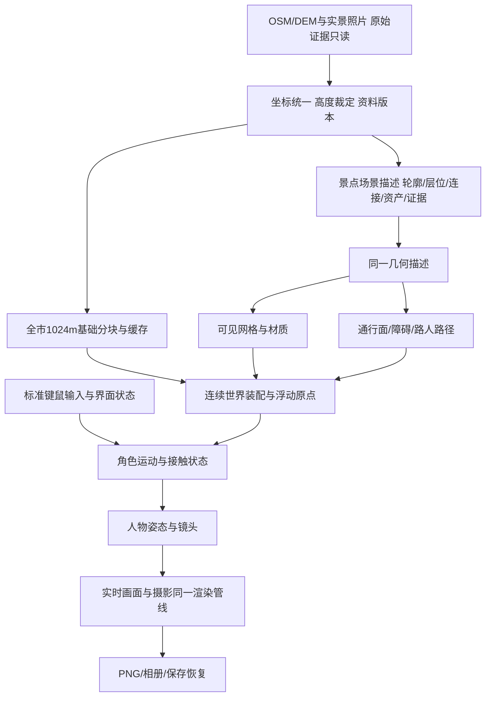

# 五一广场体验与内容架构

版本：1.0 · 2026-10-15 · 先探图、作出取舍、冻结本批影响面，再实施。

## 目标与重新判断

目标保持：全长沙、真实尺度、城区可连续步行到远郊、行走/摄影/路人、逐景85分且前三项各80%、关键事实错误零；禁止安排真人。五一广场是制作方法的样板，不能用它替代全市范围。

用户对人物、建筑、流畅度、清晰度的连续反馈说明：逐个增加杆件、店招和测试，尚未形成整体可信的城市体验。撤回“局部细节数量增加就能自然接近示例”的默认假设。重新以实际起点画面、正常操作和可识别的真实街景验证架构；工程回执只证明对应功能。

本轮先冻结这份方案。沿用已有Three.js、真实地理分块、存档/相册与已修复的8/16m/s和鼠标控制。先实施有直接观察依据、可独立回退的镜头批次，再按内容生产顺序推进；不先重写引擎。

## 探图：实际观察与已有做法

2026-10-15使用已有完整Chromium，1440×900、DPR1，通过示例UI完成“开始→角色确认→北京路→W前进→D移动→鼠标拖动→C摄影入口”，保存8张原始截图和录像；本次该探针止于摄影入口，不冒称覆盖所有功能。历史2026-10-14的实际完整摄影/相册/下载/重开证据仍保留在PRD1.4.2。

- 示例与当前长沙的实时画布均为1440×900；本次差距不能仅归因于输出像素不足。示例的骑楼、门窗、店面、铺地形成连续层次，长沙起点主要展示树和草地，平和堂/IFS在身后。
- 当前新鲜起点实测角色三维包围盒投影高315.45px，占视口35.05%；示例截图中的角色约占五分之一（人工屏幕观察估计，非相同模型的精密测量）。当前角色遮占环境较多。把镜头拉远、验证主体投影和遮挡，是可检验的因果假设。
- 本地运行帧记录206次绘制、600481三角形、139几何对象、11纹理。这是一个起点帧，不代表全程性能，也不等于美术精度。分块与合批已经存在，问题不宜笼统归因为“没有优化”。
- 源码确认当前第三人称4.3m；摄影9m；镜头遮挡射线仅在地下启用，地面靠墙时没有这项保护。画面中的透明招牌与光照、碰撞几何要分清。
- 当前材质管线已有像素贴图；部分人物/立面仍以大块色面表达。单纯统一NearestFilter不会生成缺失的门窗、立面层次与真实布局。

| 外部一手项目 | 查到的做法 | 本项目采用与取舍 |
| --- | --- | --- |
| [用户示例](https://522e7c37.pinme.dev/) | 实际北京路场景的连续街道细节、较小角色占屏、清晰的操作入口；公开脚本有分档DPR和细节半径 | 参考可观察体验与画面层次；保留长沙真实距离和全域连续世界；不移植其代码/地图/资源，不把界面米数当实测地理距离 |
| [Sketchbook](https://github.com/swift502/Sketchbook) / [角色](https://github.com/swift502/Sketchbook/blob/master/src/ts/characters/Character.ts) / [镜头](https://github.com/swift502/Sketchbook/blob/master/src/ts/core/CameraOperator.ts) | InputManager、CameraOperator和Character分开；角色有状态及速度/转向弹簧；场景可加载GLB。作者已归档 | 借鉴输入、角色运动、视觉姿态和镜头职责划分；本轮不迁移到已归档引擎，不引入车辆等无关系统 |
| [Ecctrl](https://github.com/pmndrs/ecctrl) | 控制器、输入、镜头、动画等模块；当前版本面向React Three Fiber和Rapier，角色可用ShapeCast支撑和坡面检查 | 借鉴运行状态向动画输出、镜头与移动解耦；现有项目为原生Three.js，不为这次优化引入整套React/Rapier；复杂地形物理迁移须另有失败证据与小型对照 |
| [camera-controls](https://github.com/yomotsu/camera-controls) | 镜头平滑时间与拖动平滑时间分开；碰撞用近裁面四角射线，并明确提示碰撞网格数量影响性能 | 本批原创实现五射线（中心和四角）保护地面/地下镜头，受阻立即缩近、解除后平滑恢复；近身小于1.6m时隐藏玩家，避免后脑挡住视野；不增加鼠标转向缓动延迟；候选限附近静态场景，记录开销 |
| [Bruno Simon folio-2025](https://github.com/brunosimon/folio-2025) / [World](https://github.com/brunosimon/folio-2025/blob/main/sources/Game/World/World.js) | 世界按阶段组装，树、草、街具、材质、视觉车辆、物理等有明确职责 | 采用“统一场景装配+可单独制作资产”的方式；本轮不迁移其WebGPU/TSL材质和车辆系统。可用GLB承载手工细部，待资产具备后使用本地Three.js加载器 |
| [ViziCities](https://github.com/UDST/vizicities) | 地理坐标、图层、分块/四叉树、缓存与三维引擎分开 | 保留已实现的1024m分块、缓存和浮动原点；精制景点作为覆盖层，走出样板后继续原长沙世界。老示例的远程服务和随机缺省楼高不作为生产依赖 |

一手源文件、抓取时间、SHA与树版本见[检索回执](../artifacts/architecture-scout-20261015/primary-source-receipt.json)；示例观察见[参考回执](../artifacts/architecture-scout-20261015/reference-receipt.json)，本地基线见[基线](../artifacts/architecture-scout-20261015/local-baseline.json)。外部项目做法是设计依据，不是本项目效果已经通过的证明。

## 架构与数据流

| 责任 | 现有落点与演进方式 | 接口与不变量 |
| --- | --- | --- |
| 地理与来源 | data/raw、data/chunks、geo.mjs、wuyi-heights.mjs | 原始来源不覆写；世界单位为米；采用值、来源、冲突与估计分开，禁止重新截到300m |
| 世界调度 | world.mjs保留分块请求/缓存/浮动原点/生命周期 | 负责装配、释放和跨区连续性；内容制作不新增平行地图、传送捷径或缩尺 |
| 场景描述 | 现有wuyi-data/site/underground/metro-exits逐批收敛 | 同一轮廓/层位/台阶/平台供可见几何、移动与路人读取；关键来源每对象可追踪；不在多个文件手工重复相互矛盾的高度 |
| 可见资产与材质 | wuyi/entrances/metro-render与character | 建筑按轮廓→立面分区→开间→门窗→屋顶/标识制作；材质有物理尺寸和像素密度，远近观察都检查；手工资产与GIS同坐标，身份不靠标签成立 |
| 输入/移动/人物 | app.mjs保留界面输入；motion.mjs保留响应；character.mjs供姿态 | 鼠标标准事件/拖动/锁定/释放保持；移动、转向、急停、斜向、贴墙、台阶分开测；动画依据实际位移，不能用平均FPS替代手感 |
| 镜头 | 本批提取camera-rig.mjs，world.mjs提供角色位置和附近静态候选 | 一/三人称和摄影共享；镜头半径与地理比例独立；地上地下遮挡均保护，角色/NPC不挤压镜头；鼠标输入不叠加慢速缓动 |
| 摄影与保存 | 现有capture、app、IndexedDB | 预览和导出同一渲染结果；原件可解码；画幅/时段/角色/NPC可复现，打开相册释放锁定 |

这张表是目标职责，不声称所有模块已拆分。只在一个职责出现实际重复/冲突时提取它；本轮仅提取镜头，保留地理、移动、NPC及相册主实现，避免为画架构图而大改。

## 场景内容生产顺序

每次交付一段能实际走完并取景的连续路线：广场地面→南北台阶→中层→下沉庭院→已核实出口→平和堂街面。每段同时完成可见网格、通行面、相应路人路径和真实参考对照；不先铺大量新灰盒。

1. **首屏/镜头**：原地转向平和堂与IFS方向、角色占屏控制为视口高度20–24%的初始设计区间，保护墙边与廊下镜头。该数值是本项目设计目标，不能当成参考游戏精密测量或还原评分。
2. **庭院空间**：冻结统一时期资料，优先核对曲线、上下层开口、平台及楼梯连接；场景描述先改变，再生成可见/可走/路人三种产物。完整中央/两侧空间不能由一条东侧中层廊道替代。
3. **平和堂与真实沿街**：使用已有2025照片核对裙楼高宽、弧面开间、楼层分区、花纹、塔楼和屋顶设备。逐店身份/位置须有同期资料；NIKE官方4F资料不能变成地面店，身份和招牌位置分别核实。缺证时先制作已证实的开间/门窗，不随机贴品牌。
4. **入口/绿化/街具**：已有1/2/4/8口保留；6C/6D独立命名POI不等于地面门心/层位。每口须证实“标号—坐标系—实际门口—标高—可通行连接”；同号商业口不能顶替。某口资料卡住时转做已证实庭院/立面/植被，不反复抓同一受限地图。
5. **人物/中文UI**：在统一镜头下制作头身、衣物像素/面部/发型和动作，不用单纯增加零件数衡量。字体看正常字号、层级、间距和夜间对比，保持中文可读；不凭感觉换成特殊像素字体。
6. **整段验收后扩展**：按PRD四大经典场景和全市生产顺序推广已成立的制作方法，全量范围与连续世界保持。还原门槛不变。

## 首批实施契约：镜头与起点

**因果假设**：当前角色约占35%的高度并遮住环境，起点朝向隐藏地标，且地面镜头无遮挡保护。调整取景与统一遮挡解算可以直接改善看景空间/靠墙稳定性；不会自动补齐建筑细节或关闭还原缺口。

- 写入范围：新增src/camera-rig.mjs与对应测试；修改world.mjs镜头装配、wuyi.mjs起点朝向；按需增量同步这几项到dist。
- 邻接范围：移动8/16m/s、输入事件、碰撞/台阶、人物几何、NPC路径、地理/高度、相册均保持现有实现。
- 行为：普通第三人称7m（首试6.6m的投影221.15px/24.57%，据投影比例一次校准）、摄影仍9m；附近静态网格中心/四角检测遮挡，缩近立即生效、恢复按时间平滑，缩到1.6m以内隐藏玩家后脑；第一人称维持1.72m；仅新旅程使用新朝向，原存档朝向不覆盖。
- 验收：同机位角色投影落入目标区间；自然开局可见平和堂/IFS方向；真实墙体/角点夹具可阻挡镜头；鼠标100px响应、急停、台阶、正常行走→摄影→实际下载→相册可用；观察路人地面接触。截图与夹具分开标注。
- 实测后修订查询架构：首轮五射线直接查询渲染合批网格，功能有效但更新P95由3.7ms升到17.2ms，保留为失败性能版本。改为合批前保存同源静态网格的CPU查询形状和紧包围盒；镜头仅查询附近形状，绘制合批保持。它们随区块缓存释放，坐标随浮动原点变换；没有第二套猜测碰撞模型。补充“合批/坐标重基后仍精确查询、远处物件预筛除”的回归及新实测，P95更新预算8ms。
- 回退：保留批前源码，只回退本批镜头与朝向；原始数据/旧证据不修改。若射线开销或镜头反复弹跳明显增加，先收窄候选与修正解算，不能只降画质/缩小世界来掩盖。

## 防止探图与验证空转

- 每个未知先写清“它会改变哪项决定”。单个问题首轮最多3个有针对性来源；同一通道无新证据失败两次即停止该通道。新来源/新证据可重开问题；不绕验证码，也不因此停止其他可实施内容。
- 每批只解决一组可见问题，开始前固定影响文件、预期画面、行为验收和回退。两次相同方法没有改进，保留失败结果并换假设，不继续微调同一个参数。
- 探图必须产生采用/拒绝决定和下一个实际内容单元；不只列候选。没有足够证据的关键事实保持未验证，独立工作继续。
- 功能通过与还原通过分开。镜头批次做定向回归；只有改动NPC通行/地面/台阶时重跑对应长时间观察，避免为局部改动反复600秒却不制作内容。
- 画面按同视口、同朝向/机位、同时间和画质保存前后原件；测试夹具、正常输入、诊断机位注明用途。平均FPS、测试数量、截图数量都不作为“像长沙”或手感通过的替代物。
- 上述预算是本轮执行约定，未添加自动阻断系统；镜头的碰撞与行为回归由代码/测试约束。已授权的可逆批次按此推进，不新增泛化确认门。

## 当前交付状态

探图和架构已冻结并已实施首批。新起点角色209.53px/23.28%，起点朝向平和堂/IFS；地面墙和中层廊道均阻挡镜头，中层近身玩家隐藏已在实际渲染场景确认。摄影保持9m、8/16m/s和鼠标响应保留。

最终RTX5080/D3D11实测：W正常行走11.044m；一/三人称左右键100px均转0.26rad/俯仰-0.08rad，锁定鼠标与Esc、摄影拖动通过；实际下载1920×1080 PNG并入相册。查询P95最终6.2ms，绘制/帧节奏另记原始回执，不用它们推定主观手感。最终源代码路人21.016秒短回归40/40移动，采样最大脚底约0.065m、相交标记0。

78项测试通过；21文件源/dist/HTTP一致，原始OSM哈希保持。前一阶段的61.968秒观察只属于修近身遮挡前版本，保存在query-registry-pass-before-close-avatar中，不充当最终版本长验收。普通镜头6.6m首试、17.2ms查询版本及验证脚本错误均留存，不作为最终通过依据。

[对照画面与回执](../artifacts/architecture-scout-20261015/index.html) · [最终操作](../artifacts/architecture-scout-20261015/camera-final-receipt.json) · [鼠标及起点投影](../artifacts/architecture-scout-20261015/delivery-check.json) · [源/发布一致](../artifacts/architecture-scout-20261015/source-integrity.json)。五一广场还原尚未通过85分；下一批制作共享几何的完整庭院空间，再进入逐店/平和堂、全入口及绿化街具。
